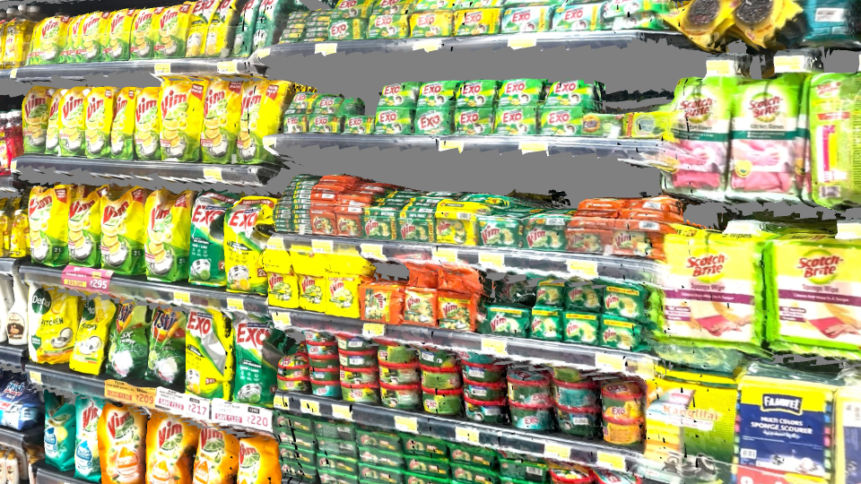
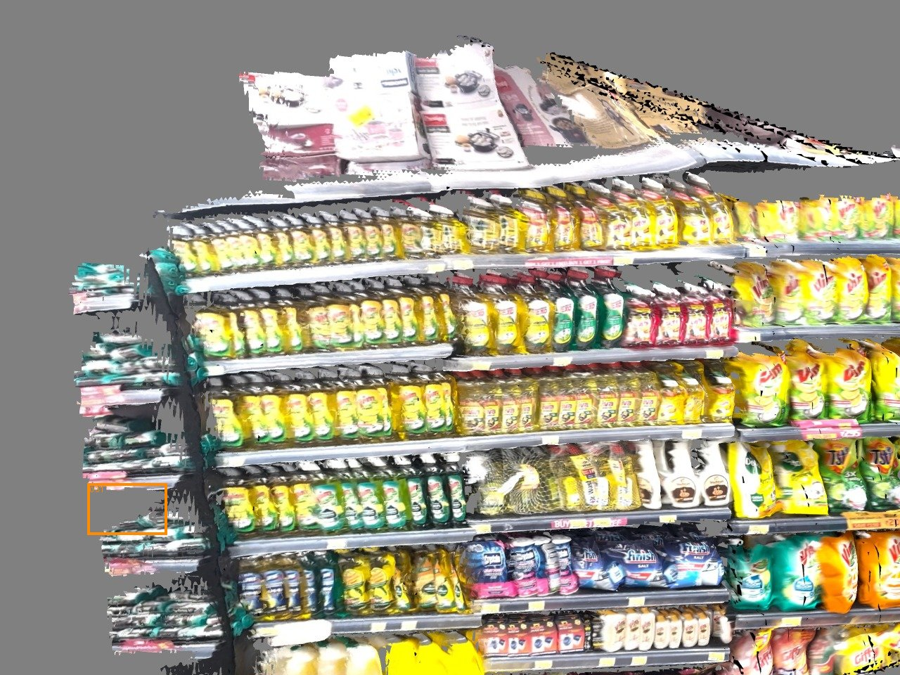
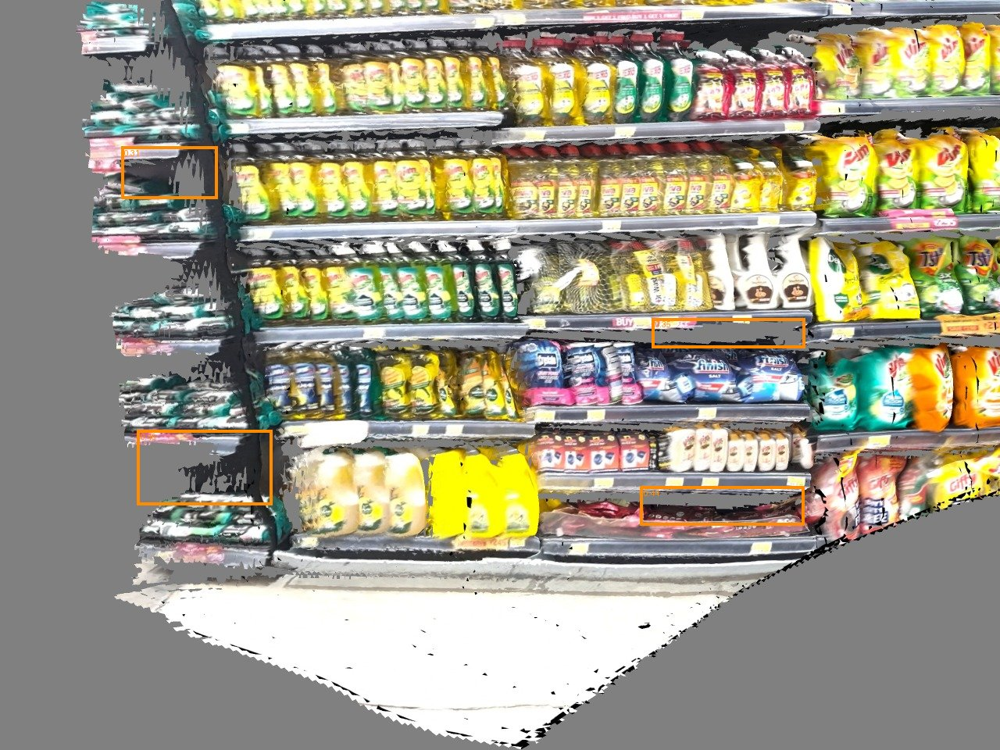

# room_scan

Tools for turning scans of retail rooms and shelves into 3D data:

1. **Phone video → textured 3D scan** (`video_to_3d/`): a handheld video becomes a UV-textured `.usdz` mesh.
2. **Open-vocabulary object localization** (`open_vocab_3d/`, `scan_perception/`): finds named objects ("chair", "coffee cup", ...) in an unsegmented USD scan and writes their 3D positions and bounding boxes to `scene_objects.json`.
3. **Empty-shelf (void) detector benchmark** (`benchmark/`): trains and evaluates YOLOv8s and RF-DETR Small on shelf void detection.
4. **Research notes** (`research/`): background notes on the approaches above.

## Results

**Video → 3D scan.** A phone video of a shelf is reconstructed into a textured 3D mesh. The image below is a frontal render of the textured `.usdz` (`video_to_3d/validate/`), with real product packaging and price labels.



**Empty-shelf (void) detection.** Both detectors were run on views of the same store scan. Boxes mark detected empty shelf space.

| YOLOv8s (trained) | RF-DETR Small (trained) |
|---|---|
|  |  |

**Benchmark numbers** (test set: 20 held-out shelf photos, 85 void boxes; from `benchmark/results/benchmark.json`):

| Model | mAP@50 | mAP@50:95 | Precision @0.25 | Recall @0.25 | Median latency (ms) |
|---|---|---|---|---|---|
| YOLOv8s, COCO weights only | 0.270 | 0.088 | 0.374 | 0.400 | 7.2 |
| YOLOv8s, trained on this data | 0.693 | 0.340 | 0.598 | 0.753 | 6.7 |
| RF-DETR Small, trained on this data | 0.744 | 0.373 | 0.556 | 0.824 | 26.7 |

The test set is small (20 images), so treat the differences as indicative.

## Repository layout

| Path | What it is | Docs |
|---|---|---|
| `room_scan.usda` | Source room scan (OpenUSD, Y-up, 1 unit = 1 m) | - |
| `video_to_3d/` | Phone video → `.usdz` pipeline (SfM, depth, TSDF, texturing) | [README](video_to_3d/README.md), [INSTALLED.md](video_to_3d/INSTALLED.md) |
| `open_vocab_3d/` | Open-vocabulary detection and 3D lifting, plus the scan app server | [README](open_vocab_3d/README.md), [CONTRACT.md](open_vocab_3d/CONTRACT.md), [API.md](open_vocab_3d/app/API.md) |
| `scan_perception/` | Isaac Sim render → 2D detection → 3D clustering | [README](scan_perception/README.md), [GUIDE](scan_perception/GUIDE.md) |
| `benchmark/` | YOLOv8s vs RF-DETR Small on empty-shelf detection | [README](benchmark/README.md) |
| `research/` | Research notes | - |
| `textures/` | Texture images used by the scans | - |

## What is and is not in git

This repository holds source code, configuration, documentation and small reference files. The following are **not** committed because they are too large for GitHub (100 MB per file limit) or are generated:

- Virtual environments (`.venv/`), about 8 to 15 GB each
- Model weights and checkpoints (`*.pt`, `*.pth`, `*.ckpt`)
- Input videos (`video/`)
- Generated outputs (`out/`, `work/`, `runs/`, `validate/`), such as `.usdz`, `.glb`, `.ply`, and COLMAP `database.db` files
- The benchmark dataset (`benchmark/data/`). It is CC BY-NC-SA 4.0, for benchmark use only, and must be downloaded separately (see `benchmark/README.md`)

See `.gitignore` for the full list. Keep a copy of the excluded files somewhere else (external drive or cloud storage) before deleting the local folder. Regenerate outputs with the pipelines below, and re-download model weights with the commands given.

## Prerequisites

- Linux with an NVIDIA GPU. The pinned PyTorch builds use CUDA 12.8 (tested on RTX 50xx / Blackwell, sm_120). Other GPUs need a PyTorch build that matches their driver.
- NVIDIA driver supporting CUDA 12.8 or newer
- **Python 3.12** (`python3.12 --version`). Ubuntu: `sudo apt install python3.12 python3.12-venv`
- `ffmpeg` is optional. PyAV bundles its own FFmpeg.
- **Isaac Sim 4.5 or 5.x** only for the Isaac-based render stages (`scan_perception/render_views.py`, `open_vocab_3d/render_views.py`). The `lite` renderer in `open_vocab_3d` and the whole of `video_to_3d` do not need it.

## Installation

Each component has its own virtual environment. Do not share one across them. Run these from the repository root.

### 1. Clone

```bash
git clone https://github.com/saumypranatree/WiseAnalytics_POC.git room_scan
cd room_scan
```

### 2. video_to_3d (phone video → USDZ)

```bash
cd video_to_3d
python3.12 -m venv .venv
.venv/bin/pip install --upgrade pip
.venv/bin/pip install -r requirements.txt
```

The first run downloads the Depth Anything V2 Small model (about 95 MB) into `models/hf`. Set `HF_HUB_OFFLINE=0` for that run only. Later runs work offline.

```bash
HF_HUB_OFFLINE=0 ./run_all.sh "../video/IMG_5198 (2).MOV" IMG_5198   # first run
./run_all.sh "<video.MOV>" <STEM> [scanned_height_m=1.9]               # later runs
```

Outputs: `out/<STEM>/<STEM>.usdz` and `out/<STEM>/<STEM>_h264.mp4`. Details: [video_to_3d/README.md](video_to_3d/README.md).

### 3. open_vocab_3d (detection and 3D lifting, plus the app server)

Stages 2 and 3 (detection and lifting) run in a normal Python environment:

```bash
cd open_vocab_3d
python3.12 -m venv .venv
.venv/bin/pip install -r requirements.txt
```

For the web app server, use the pinned app requirements in a separate environment:

```bash
cd open_vocab_3d
python3.12 -m venv .venv-app
.venv-app/bin/pip install --no-cache-dir -r requirements-app.txt
```

Run the full pipeline (use `RENDERER=lite` for CPU rendering without Isaac Sim):

```bash
RENDERER=lite PY=.venv/bin/python ./run_pipeline.sh scenes/room_scan_upright.usda out
```

The USD scene file `room_scan_upright.usda` must be present (`scenes/`). Details: [open_vocab_3d/README.md](open_vocab_3d/README.md).

### 4. scan_perception (Isaac Sim render → detect → cluster)

Stage 1 (rendering) uses Isaac Sim's Python. Stages 2 and 3 use a regular Python environment:

```bash
cd scan_perception
python3.12 -m venv .venv-cv
.venv-cv/bin/pip install -r requirements-cv.txt
```

Install PyTorch for your CUDA version first if the default build is wrong: https://pytorch.org/get-started/locally/

Run the pipeline:

```bash
ISAAC_PY=~/isaacsim/python.sh CV_PY=.venv-cv/bin/python \
  ./run_pipeline.sh ../room_scan.usda out chair monitor "coffee cup" table
```

Details: [scan_perception/README.md](scan_perception/README.md) and [scan_perception/GUIDE.md](scan_perception/GUIDE.md).

### 5. benchmark (empty-shelf detectors)

```bash
cd benchmark
python3.12 -m venv .venv
.venv/bin/pip install -r requirements.txt
```

The dataset is not in the repository. Download it and place it under `benchmark/data/raw/` (see [benchmark/README.md](benchmark/README.md)).

## Running the tests

```bash
cd open_vocab_3d && .venv/bin/python -m pytest tests -q
cd scan_perception && .venv-cv/bin/python -m pytest tests -q
```

## Notes

- The scan's up axis and scale matter. `room_scan.usda` is Y-up with 1 unit = 1 m, but its content is upside down. Use `open_vocab_3d/scenes/room_scan_upright.usda` (a 180° rotation about X) for detection. See [open_vocab_3d/README.md](open_vocab_3d/README.md).
- Scale from monocular video is provisional. `video_to_3d` assumes a 1.9 m scanned height unless you pass another value. See the limitations in [video_to_3d/README.md](video_to_3d/README.md).
- Licenses: `video_to_3d/INSTALLED.md` lists the licenses of its dependencies. The FFmpeg build inside PyAV is GPL. The benchmark dataset is CC BY-NC-SA 4.0 and must not be used commercially.
